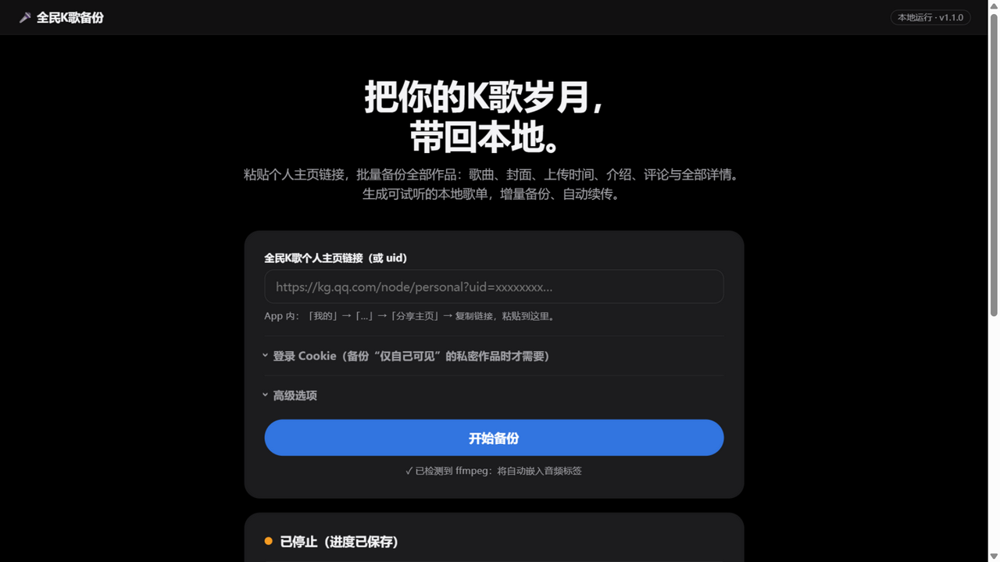
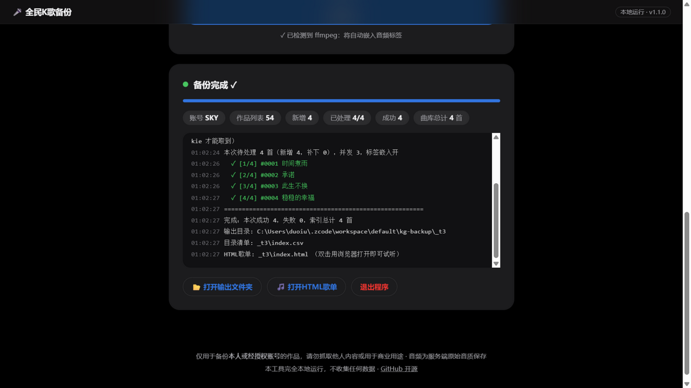

# 🎤 全民K歌备份工具（WeSing Backup）


**把你的全民K歌作品一键备份到本地** —— 歌曲、封面、MV、上传时间、介绍文案、评论、评分与全部详情，
并生成可直接试听的本地 HTML 歌单 + Excel 目录。完全本地运行，不收集任何数据。

| 主界面 | 备份完成 |
|---|---|
|  |  |

## ✨ 特性

- **一键备份**：粘贴个人主页链接（或 uid）即可，无需命令行
- **最高音质**：保存服务端原始 AAC 流，不转码、不二次压缩
- **全部详情**：标题、上传时间、介绍文案、评分、播放/点赞/评论/鲜花/礼物数、合唱搭档、录制设备、完整接口 JSON
- **本地歌单（五样式切换）**：`index.html` 顶部胶囊切换——📋 目录（搜索/排序/试听）、
  🎧 黑胶（精修：唱片细槽/封面倒影/落针）、📼 卡座（转轴/VU电平表/LED）、
  🌈 频谱（全屏封面模糊背景/实时频谱）、🎙 点唱机（霓虹拱顶/彩虹灯）；
  黑胶/卡座/频谱带歌词卡拉OK逐行滚动；切换自动记忆，换肤不停播；另附独立 `cd.html`
- **Cookie 体检**：粘贴 Cookie 后一键检测有效性（昵称/可见作品数），附图文获取教程
- **增量备份**：重跑自动跳过已备份作品，新歌/失败项自动补齐；误删文件自动修复
- **音频标签**：标题/歌手/日期/文案/封面/歌词自动写进 m4a（无损 `-c copy`，需系统安装 [ffmpeg](https://www.gyan.dev/ffmpeg/builds/)，可选）
- **歌词**：自动获取带时间轴的 LRC 歌词——保存 `.lrc` 边车文件（播放器可滚动显示）并写入音频歌词标签；仅用于个人欣赏自己唱过的作品，请勿用于商业用途
- **MP3 副本 / ZIP 打包 / MV 视频**：一键可选
- **失败自动重试**：单文件重试 3 次 → 整批结束自动重试一轮 → 重跑继续补，failed.json 留档
- **两种文件布局**：默认按 audio/covers/meta 分目录；也可勾选「文件放一起」同前缀成组（.m4a/.lrc/.jpg/.json 躺一个目录）
- **私密作品**：登录 Cookie 可连同"仅自己可见"的作品一起备份
- **代理支持**：`--proxy http://127.0.0.1:7890`

## 📥 下载使用（Windows）

1. 到 [Releases](../../releases) 下载 `KG-Backup.exe`（约 10MB，免安装）
2. 双击运行，浏览器会自动打开操作页面
3. 粘贴主页链接 → 点「开始备份」，完事

> macOS / Linux 用户：`pip install requests && python kg_app.py`（或 `python kg_backup.py <主页链接>` 用命令行）

## 🚀 使用方法

**图形界面**：双击 `KG-Backup.exe`（或 `python kg_app.py`）

**命令行**：

```bash
pip install requests

# 备份全部公开作品
python kg_backup.py "https://kg.qq.com/node/personal?uid=xxxxxxxxxxxxxxxx"

# 含私密作品（Cookie 获取方法见下）
python kg_backup.py <uid> --cookie-file cookie.txt

# 常用组合
python kg_backup.py <uid> --proxy http://127.0.0.1:7890     # 走本地代理
python kg_backup.py <uid> --since 2019-01-01 --until 2021-12-31
python kg_backup.py <uid> --mp3 --zip                       # MP3副本 + 打包
python kg_backup.py <uid> --list-only                       # 只看清单不下载
```

<details>
<summary><b>🔑 如何获取 Cookie（备份私密作品时才需要）</b></summary>

1. 电脑 Chrome/Edge 打开 https://kg.qq.com 并登录 QQ
2. `F12` → Network（网络）→ 刷新页面
3. 点任意发往 `kg.qq.com` 的请求 → Headers（标头）→ 复制 `Cookie:` 后面的**完整**内容
4. 保存为一行文本到 `cookie.txt`，运行时加 `--cookie-file cookie.txt`（图形界面直接粘贴进 Cookie 输入框）

Cookie 只保存在本机、只发往腾讯服务器，本工具不含任何上传行为。
</details>

## 📤 输出结构

```
kg_backup_昵称/
├── index.html     ← 双击打开：可试听/搜索/排序的本地歌单
├── cd.html        ← 复古CD机：黑胶旋转 + 粒子 + 歌词卡拉OK
├── index.csv      ← Excel 总目录（全部详细信息）
├── index.json     ← 增量备份索引
├── audio/         ← 歌曲：序号_日期_歌名.m4a（原始码率不转码）+ 同名 .lrc 歌词
├── covers/        ← 封面图 + 介绍配图
└── meta/          ← 每首完整详情 JSON + 评论
```

## ❓ FAQ

<details>
<summary><b>音质是什么水平？能拿到无损吗？</b></summary>
全民K歌服务端存储的就是 AAC 音频（约 80–130kbps，越新的作品码率越高），工具按原始流原样保存、绝不转码，这就是公开渠道能拿到的最高音质；服务端没有无损音源，转出 FLAC 是假无损。
</details>

<details>
<summary><b>为什么列表数量比账号显示的少？</b></summary>
差值一般是「仅自己可见」的私密作品，需要登录 Cookie 才能取到。带 Cookie 备份时如果仍有差值，工具会明确提示 Cookie 可能过期。
</details>

<details>
<summary><b>能导出全部历史评论吗？</b></summary>
每首歌会导出最新约 10 条评论及评论总数。全量历史评论只有 App 内签名接口能取，网页渠道（本工具）无法获得——我们扫描了全部前端代码确认过，不是不想做。
</details>

<details>
<summary><b>CSV/HTML 里的"网页链接"打不开了？</b></summary>
全民K歌的分享链接（shareid）有有效期，几小时到几天不等。备份下来的音频、封面、详情 JSON 才是长期资产；meta/ 下记录了每首的 ugc_id，配合工具重跑即可找回任何作品。
</details>

<details>
<summary><b>下载会弄脏我的账号吗？</b></summary>
工具只读取公开页面数据，带轻微限速与失败重试，默认并发 3。请勿调高并发狂拉他人主页。
</details>

<details>
<summary><b>浏览器/杀软提示"检测到病毒"？</b></summary>
这是<b>误报</b>。本工具是 PyInstaller 打包且没有购买商业数字签名（签名证书需每年数百元），杀软对"未签名的单文件打包 exe"普遍敏感，并非真的有病毒——全部源码开源在仓库里可自行审查或自己打包。绕过方法：Edge/Chrome 下载时点「…」→「保留」→「仍然保留」；Windows 若拦截，在"病毒和威胁防护"→"保护历史记录"里选择允许。建议优先下载 Release 里的 <b>ZIP 版本</b>，被拦概率低很多。
</details>

<details>
<summary><b>meta 里的 JSON 有什么用？Emby / Plex 能读吗？</b></summary>
Emby / Plex / Jellyfin <b>不读</b>这个 JSON（它是给你和程序看的完整存档，浏览器/记事本/VSCode 都能打开）。媒体服务器真正读取的是<b>音频内嵌标签</b>——本工具已把标题/歌手/专辑/日期/封面/歌词全部写进 m4a，媒体服务器的音乐库直接识别，无需额外文件。人看的目录用 <b>index.html</b>（浏览器）和 <b>index.csv</b>（Excel）。
</details>

<details>
<summary><b>日志里出现 ✗ 怎么办？会重试吗？</b></summary>
会的，三层保障：① 每个文件下载失败自动重试 3 次；② 整批跑完后，失败的会<b>当场自动再重试一轮</b>；③ 重跑同一命令，剩余失败项继续补。全部失败项记录在 failed.json。
</details>

## 🇬🇧 English (Quick Start)

**WeSing Backup** — one-click local backup of your (or an authorized) 全民K歌 / WeSing account: songs (original AAC stream, no re-encoding), covers, MVs, upload time, descriptions, comments, and full metadata — plus a local HTML songbook you can play, search and sort, and an Excel index.

```bash
# Windows: download KG-Backup.exe from Releases and double-click, or:
pip install requests
python kg_app.py                                   # GUI (opens your browser)
python kg_backup.py "https://kg.qq.com/node/personal?uid=xxx"   # CLI, all public works
python kg_backup.py <uid> --cookie-file cookie.txt              # include private works
```

Run **locally only**; no data collection. Please back up only your own or authorized accounts. See the Chinese sections above for details.

## ⚠️ 使用须知

本项目仅用于**备份本人或经授权账号**的作品、留存个人记忆，请勿用于批量抓取他人内容、商业用途或任何违反全民K歌用户协议的场景。歌词与音乐版权归原权利方所有。


## 🐳 Docker 部署（可选，NAS/服务器玩家）

备份引擎跑在容器里，浏览器打开 `http://NAS的IP:8765` 即可操作，备份文件落在挂载目录：

```bash
# 方式一：直接用发布镜像（推荐）
docker run -d --name wesing-backup -p 8765:8765 \
  -v "$PWD/backups:/data" --restart unless-stopped \
  ghcr.io/suntreef/wesing-backup:latest

# 方式二：本仓库构建
git clone https://github.com/suntreef/wesing-backup && cd wesing-backup
docker compose up -d
```

镜像内置 ffmpeg（自动嵌标签/MP3 副本）。旧备份目录放进挂载卷后重跑一次备份即可自动升级（补歌词/标签，无需重新下载音频）。镜像仅用于个人备份，请勿公开暴露到公网。

## 🛠 开发

```
core.py      备份核心（CLI / GUI 共用，支持进度回调与取消）
kg_app.py    图形界面：本地服务器 + 自动打开浏览器
kg_backup.py 命令行入口
static/      前端单页（原生 HTML/CSS/JS，无构建）
```

本地构建 exe：`pip install pyinstaller && pyinstaller --onefile --noconsole --name KG-Backup --add-data "static;static" kg_app.py`

## License

[MIT](LICENSE)
